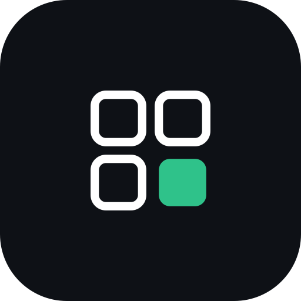
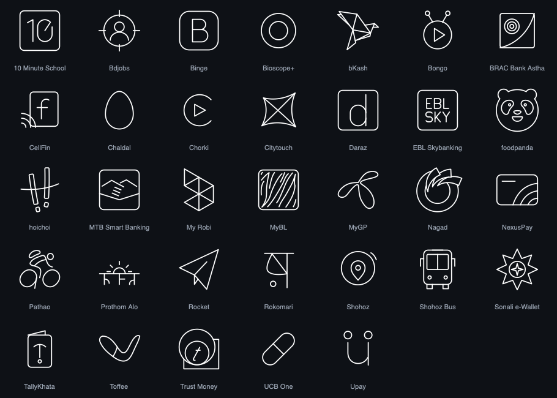

<p align="center">
  
</p>

<h1 align="center">Iconz</h1>

<p align="center">
  <strong>A free, open-source line icon pack for Android, with Bangladeshi apps.</strong><br />
  15,000+ thin white line icons, including bKash, Nagad, Rocket, Upay, Pathao, MyGP, Daraz and Bangladeshi banks.
</p>

<p align="center">
  <a href="https://github.com/dhruba-datta/iconz/releases/latest/download/iconz.apk"><strong>Download for Android</strong></a> ·
  <a href="https://github.com/dhruba-datta/iconz/releases">All releases</a>
</p>

---

Most icon packs skip the apps people in Bangladesh use every day. Iconz takes the 15,000+
icons of [Arcticons](https://github.com/Arcticons-Team/Arcticons) and adds the Bangladeshi
apps they're missing, drawn in the same style.

<p align="center"></p>

## Install

1. On your Android phone, download **[iconz.apk](https://github.com/dhruba-datta/iconz/releases/latest/download/iconz.apk)**.
2. Open it. If Android asks, allow your browser to **install unknown apps**, then tap **Install**.
3. Open Iconz and tap **Apply**, or pick Iconz in your launcher's icon pack setting.

Works with launchers that support icon packs: Lawnchair, Nova, Smart Launcher, Niagara,
Hyperion, Action Launcher and others. Pixel and Samsung's own launchers don't take icon
packs. An icon appears on an app only if Iconz has that app; the rest keep their own icon. Needs Android 8.0 or newer.

## What it does (and doesn't)

Iconz is only icons. It asks for **no permissions**: no internet, no access to your other
apps or files. To update, download the latest `iconz.apk` again; it installs over the old
one.

Every release is signed with the same key. Check a download with
`apksigner verify --print-certs iconz.apk`; the certificate's SHA-256 digest must be:

```
06e526fa283b9c5ba93c4074532c4780fe3528a9f838b3174bdd5b8a33588bd6
```

## Missing an app?

Open an [issue](https://github.com/dhruba-datta/iconz/issues) with the app's name. With the
phone plugged into a computer (USB debugging on), `python3 tool/scan_phone.py` lists every
app on it that has no icon yet.

## Building

```sh
python3 tool/build_icons.py      # writes appfilter.xml, drawable.xml from icons/icons.json
./gradlew assembleDebug          # JDK 17 and the Android SDK
```

Iconz's own icons are SVGs in `icons/svg/` (48×48, white strokes of width 1, round caps and
joins, no fill, like Arcticons). Add one there and to `icons/icons.json`, run
`tool/build_icons.py`, and preview the Bangladesh set with `tool/preview_icons.py`.
`tool/import_arcticons.py` refreshes the Arcticons icons from a checkout of that repository.

## Licence

Icons: [CC BY-SA 4.0](LICENSE-ICONS.md). Most are from
[Arcticons](https://github.com/Arcticons-Team/Arcticons) by Donnnno and the Arcticons
contributors; the Bangladeshi ones are drawn for Iconz. Code: [MIT](LICENSE).
App names and logos are trademarks of their owners; Iconz is not affiliated with or
endorsed by any of them.
